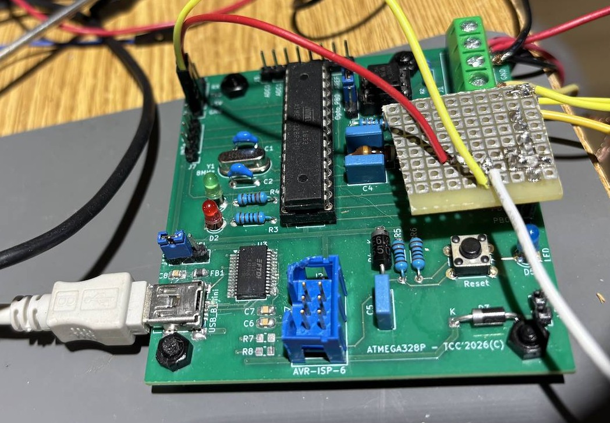

# ATmega328P Weather Station

Firmware and KiCad designs for an ATmega328P weather station and its battery-powered LoRa sensor nodes. The master reads local wind, rain and temperature sensors, displays measurements on an OLED, stores records in I²C EEPROM, and receives remote BME280 readings over LoRa.

The original trainer board includes an optocoupled input for pulse sensors, including 24 V anemometers, and an FT232 USB-to-serial interface.



[PCB project page](https://www.pcbway.com/project/shareproject/Anemometer_with_ATMega128P_fbefd825.html) · [Master schematic (PDF)](schematic/anemometre.pdf) · [IOExtension schematic (PDF)](schematic/IOExtension/IOExtension/IOExtension.pdf) · [Local LoRa/BME280 schematic (PDF)](schematic/lora_bme280_local/lora_bme280_local/lora_bme280_local.pdf)

## Features

- Wind speed from an anemometer and rainfall counting.
- Local temperature from a DS18B20 and indoor temperature, humidity and pressure from a BME280.
- SSD1306 OLED with text and temperature-graph views.
- MCP23017 I/O expander, including an external LED and view button.
- I²C EEPROM logging and weather forecast calculations.
- SX1276/78 LoRa support for up to two remote BME280 nodes.
- Separate firmware target for the low-power remote node.
- Optional BME280 and LoRa devices are detected at startup; if the LoRa module is absent, the master reports it over UART and continues with local functions.

## Hardware

### Master board

| ATmega328P pin | Function |
| --- | --- |
| PB0 | Anemometer input capture (ICP1) |
| PB1 | Rain gauge input (PCINT1) |
| PB2 | DS18B20 1-Wire data; use a 4.7 kΩ pull-up |
| PB3/PB4/PB5 | SPI MOSI/MISO/SCK for the LoRa module |
| PC4/PC5 | I²C SDA/SCL, 100 kHz |
| PD0/PD1 | UART RX/TX, shared with the onboard FT232 |
| PD2/PD3 | LoRa chip select/reset |
| PD6 | Status LED |

The I²C bus is shared by the MCP23017 (`0x20`), SSD1306 (`0x3C`), EEPROM (`0x54`) and BME280 (`0x76`). PB2 is also the ATmega328P SPI `SS` pin, so the firmware suspends SPI while it communicates with the DS18B20 and restores SPI master mode afterward.

The master MCU operates at 8 MHz. The RFM95W/Ra-02 LoRa module is a **3.3 V device**; use a suitable 3.3 V regulator and level shifting between it and a 5 V MCU. Keep the module's chip-select pulled high so ISP programming does not select the radio.

### LoRa remote node

The remote uses an ATmega328P at 3.3 V / 8 MHz, a BME280 and an SX127x radio. It transmits approximately every 64 seconds and sleeps between transmissions. Build node 1 by default; node 2 starts with a 32-second offset to reduce collisions. The master marks a node offline after 180 seconds without a packet.

For remote battery measurement, connect VIN to PC0/ADC0 through a divider: VIN—470 kΩ—PC0—330 kΩ—GND, with 100 nF from PC0 to GND. PC0 is not connected on the current remote PCB, so the divider must be wired to the ATmega328P pin 23. The reported voltage assumes a 3.3 V ADC reference and these resistor values; calibrate for best accuracy.

## Build

Install CMake and the AVR toolchain (`gcc-avr`, `avr-libc`; `binutils-avr` may be a separate package on your system). The master and remote are separate CMake projects.

### Master firmware

From the repository root:

```sh
cmake -S src -B src/build
cmake --build src/build
```

The build creates `src/build/firmware.elf` and `src/build/firmware.hex`. If CMake cached a host compiler instead of `avr-gcc`, use a fresh build directory and configure again.

### LoRa remote firmware

```sh
cmake -S src/lora_remote -B src/lora_remote/build
cmake --build src/lora_remote/build
```

To build node 2, use a separate build directory:

```sh
cmake -S src/lora_remote -B src/lora_remote/build_node2 -DLORA_NODE_ID=2
cmake --build src/lora_remote/build_node2
```

The remote's optional UART diagnostics are disabled by default. Enable them with `-DLORA_DEBUG_UART=ON` in a separate build directory; output is 9600 baud, 8N1, on PD1/TXD and uses 3.3 V logic levels.

```sh
cmake -S src/lora_remote -B src/lora_remote/build_debug -DLORA_DEBUG_UART=ON
cmake --build src/lora_remote/build_debug
```

The remote build creates `firmware_remote.elf` and `firmware_remote.hex` in its selected build directory. For UART diagnostics, connect a 3.3 V USB-to-serial adapter's RX to PD1/TXD and connect GND; the remote only transmits debug output.

Both projects provide a `flash` target that invokes `avrdude` with the `dragon_isp` programmer. Select the appropriate build directory and connect the programmer before running it:

```sh
cmake --build src/build --target flash
cmake --build src/lora_remote/build --target flash
```

## Master serial interface

The master UART is 9600 baud, 8N1 on PD0/PD1, exposed through the onboard FT232. Commands are terminated by CR or LF.

| Command | Purpose |
| --- | --- |
| `@GET_ANEMO` | Read wind speed |
| `@GET_RAIN` | Read rain-tip count and rainfall |
| `@RESET_RAIN` | Reset the rain counter |
| `@GET_TEMP` | Read the DS18B20 temperature |
| `@GET_BME` | Read the latest indoor BME280 data |
| `@GET_EXT` | Read remote node 1 status (alias for `@GET_EXT1`) |
| `@GET_EXT1`, `@GET_EXT2` | Read the selected remote node status |
| `@VIEW` | Toggle OLED text/graph view |
| `@DUMP` | Dump logged EEPROM records |
| `@FORECAST` | Print the current forecast |
| `@MCP_ON <pin>`, `@MCP_OFF <pin>` | Set an MCP23017 output; use `A0`–`A6` or `B0`–`B7` (port A is the default) |

The OLED text view shows both the exterior DS18B20 and indoor BME280 temperatures. `src/test.py` is an older host-side script and still uses legacy `@STAT_*` command names.

## Repository layout

- `src/weatherstation/` — master firmware and shared sensor, display, I²C, SPI, EEPROM and LoRa drivers.
- `src/lora_remote/` — battery-powered remote-node firmware.
- `schematic/` — KiCad schematics and PCB designs for the master and LoRa nodes.
